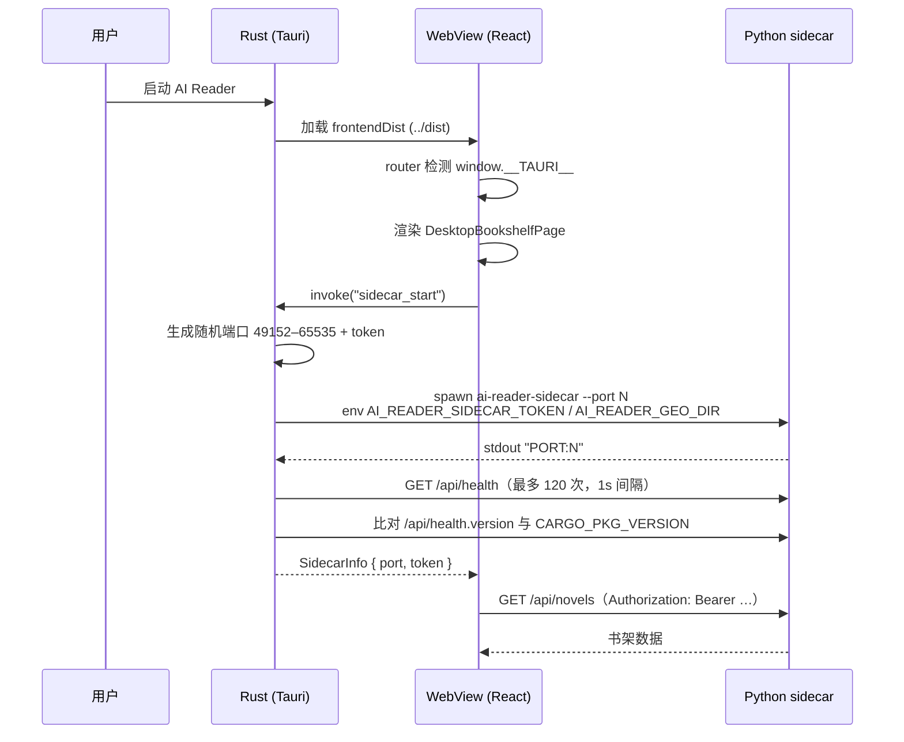
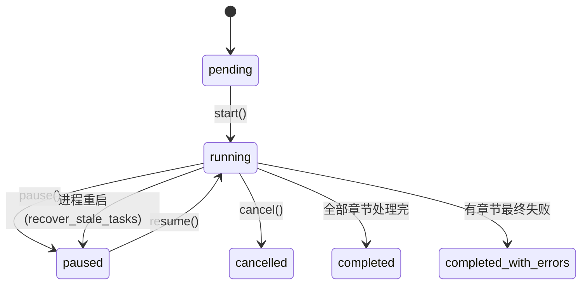

# 02 · 运行时与生命周期

## 一句话概括

桌面版是**双进程模型**：Rust 主进程负责窗口、原生能力与 sidecar 监管；Python 子进程承载全部业务。两者之间只有 HTTP + WebSocket，靠**随机端口 + 每次启动生成的 Bearer token** 建立信任，再用 **health + 版本握手** 保证升级后不会出现新旧组件混装。

## 桌面启动时序

关键实现：`frontend/src-tauri/src/lib.rs:54-237`。

- **端口**：`rand::thread_rng().gen_range(49152..=65535)`，避免与常见服务冲突。
- **token 传递**：走环境变量 `AI_READER_SIDECAR_TOKEN`，不放进命令行参数，避免同机进程通过 `ps` 读到（`lib.rs:75` 注释明确此意图）。
- **超时**：等 `PORT:` 最长 120s，健康检查最多 120 次。注释解释了原因——PyInstaller onefile 冷启动要解包并 import scipy/numpy，Windows 还有杀软扫描。
- **版本握手（issue #71）**：健康检查通过后再读 `/api/health` 的 `version`，与 `CARGO_PKG_VERSION` 不一致就杀进程并给出"结束残留进程后重装"的提示。这解决"升级后旧 sidecar 仍占端口"的问题。
- **失败诊断**：保留最后 20 行 stderr；崩溃日志写在 `~/.ai-reader-v2/sidecar-crash.log`（`backend/sidecar_entry.py:22-46`）。

### sidecar 生命周期

| 命令 | 作用 | 位置 |
| --- | --- | --- |
| `sidecar_start` | 启动并返回 `{port, token}` | `lib.rs:54` |
| `sidecar_status` | 查询当前端口/token（不启动） | `lib.rs:273` |
| `sidecar_stop` | 杀子进程并清空状态 | `lib.rs:261` |
| `save_export` | Rust 直接向 localhost 拉流写盘（大文件不走 IPC） | `lib.rs:244` |

退出时由 Tauri 的 `RunEvent::Exit` 兜底 kill；Windows 用 `taskkill /T /F` 杀进程树，其他平台 `child.kill()`（`lib.rs:41-52`）。

## 前端如何拿到后端地址

`frontend/src/api/sidecarBridge.ts` 是唯一入口，结果被模块级缓存：

1. `isTauri()` 判断 `window.__TAURI__`；
2. `ensureSidecar()` → `invoke("sidecar_start")`（正在启动时并发调用会复用同一 Promise）；
3. `getSidecarBaseUrl()` = `http://127.0.0.1:{port}`；
4. `getSidecarWsUrl()` = `ws://127.0.0.1:{port}`，WS URL 追加 `?token=`；
5. `sidecarAuthHeaders()` 返回 `Authorization: Bearer …`。

`frontend/src/api/client.ts` 在 Tauri 模式拼 `getSidecarBaseUrl() + "/api"`，否则用相对路径 `/api`（Vite dev 代理到 `localhost:8000`），并对所有请求自动附加鉴权头。**页面代码不感知运行形态**。

## 后端启动

入口分两种：

| 形态 | 入口 | 行为 |
| --- | --- | --- |
| 桌面 | `backend/sidecar_entry.py` | 解析 `--port/--host/--token`，打印 `PORT:`，`uvicorn.run(app)` |
| 开发/Web | `uvicorn src.api.main:app` | 默认 8000，`/api` 由 Vite 代理 |

### FastAPI lifespan（`src/api/main.py:95-105`）

按顺序执行，每步失败都不阻塞启动（除 `init_db`）：

1. `init_db()` — 建表 + 幂等迁移 + `ensure_data_dir()`；
2. `_restore_persisted_settings()` — 从 `app_settings` 恢复 `llm_mode`、云 provider 的 base_url/model、API key（经 keyring）、max_tokens；
3. `_detect_context_window()` — 探测模型上下文窗口（见 [05](05-llm-and-quality-control.md)）；
4. `auto_import_samples()` — 首次运行导入随包示例小说；
5. `recover_stale_tasks()` — 上次进程遗留的 `running` 分析任务改为可恢复状态；
6. `recover_stale_passes()` — 二审 pass 的 `running → paused`。

### 中间件顺序

`SidecarAuthMiddleware` 先于 CORS 加入（Starlette 后加者先执行，实际请求先过 CORS 再鉴权）。鉴权规则（`main.py:111-154`）：

- 未配置 token（Web 直跑 / 开发）→ 全放行；
- `/api/health` 与 `OPTIONS` 豁免；
- HTTP：`Authorization: Bearer <token>` 精确匹配；
- WebSocket：`?token=<token>`（浏览器/WebView 不能给 WS 加自定义头），失败关闭码 `4401`。

CORS 用正则 `^(https?|tauri)://((tauri\.)?localhost|127\.0\.0\.1)(:\d+)?$`，不允许任意 Origin。

## 数据目录与进程内状态

| 路径 | 内容 |
| --- | --- |
| `~/.ai-reader-v2/`（可由 `AI_READER_DATA_DIR` 覆盖） | 数据根目录 |
| `data.db` | SQLite 主库（WAL 模式，见 `get_connection`） |
| `chroma/` | ChromaDB 持久化目录 |
| `geonames/` | 地理数据集缓存 |
| `sidecar-crash.log` | sidecar 崩溃诊断 |

所有路径常量集中在 `src/infra/config.py:8-11`。

进程内状态（**不持久化，重启即丢**）：

- `AnalysisService` 单例（`get_analysis_service`）：`_tasks`（运行中的 asyncio Task）、`_live_timing`（实时每章耗时）、`_retry_progress`、`_ChapterFactsCache`；
- `_ConnectionManager`：`novel_id → set[WebSocket]`，用于分析事件广播；
- `analysis_service` 的 `_facts_cache` 在章节落库后失效。

多本小说可以同时分析：每个 `start()` 都 `_spawn_background` 一个独立协程，共用一个 service 实例，但 `FactValidator` / `NameResolver` 都是**每次运行新建**（`analysis_service.py:445-500`），避免跨小说状态污染。

## 任务生命周期

- 任务粒度是 **chapter range**（`chapter_start`–`chapter_end`），不是整本。
- `start()` 支持 `force=True` 重跑已完成章节；否则跳过 `analysis_status == "completed"`。
- 被用户排除的章节（`is_excluded`）无论如何都跳过，只推进进度。
- `resume()` 从 `current_chapter` 继续；`retry_failed_chapters()` 只重跑 `failed` 行，并在后台协程里用 `retry_start/retry_progress/retry_done` 事件回报。
- 单章失败不会中止整本：记录 `error_type` + `error_msg`，继续下一章，跑完后统一自动重试（见 [04](04-analysis-pipeline.md)）。

## 长任务与前台请求的隔离

| 通道 | 用途 | 实现 |
| --- | --- | --- |
| REST | 增删改查、启动/暂停/恢复、导出 | 普通 async handler |
| `/ws/analysis/{novel_id}` | 分析进度、阶段标签、地图预建、层级更新 | `_ConnectionManager.broadcast` |
| `/ws/chat/{session_id}` | 问答流式 token | `query_stream` async generator |
| 后台 Task | 分析、二审、地理链、实体消解、地图预建 | `asyncio.create_task` + 异常日志 |

后台任务**全部非致命**：`_run_geo_pipeline` 里每一步各自 try/except，地图预建失败只广播 `error` 状态；层级重建失败只 warn。前端因此可以"分析完就离开"，回来再看到派生数据。

## 失败模式速查

| 现象 | 根因 | 定位 |
| --- | --- | --- |
| "后端启动超时（120秒）" | onefile 解包慢 / 杀软拦截 | `lib.rs:162-167` |
| "后端组件版本不匹配" | 升级残留旧 sidecar | `lib.rs:202-224` |
| 401 / WS 4401 | token 缺失或过期 | `main.py:140-154` |
| "未安装嵌入依赖（chromadb）" | 未装 `embed` extra | `embedding_service.py:31-40` |
| 地图空白但图谱正常 | 地图预建失败（非致命） | WS `map_prebuild: error`，`analysis_service.py:1646-1657` |
