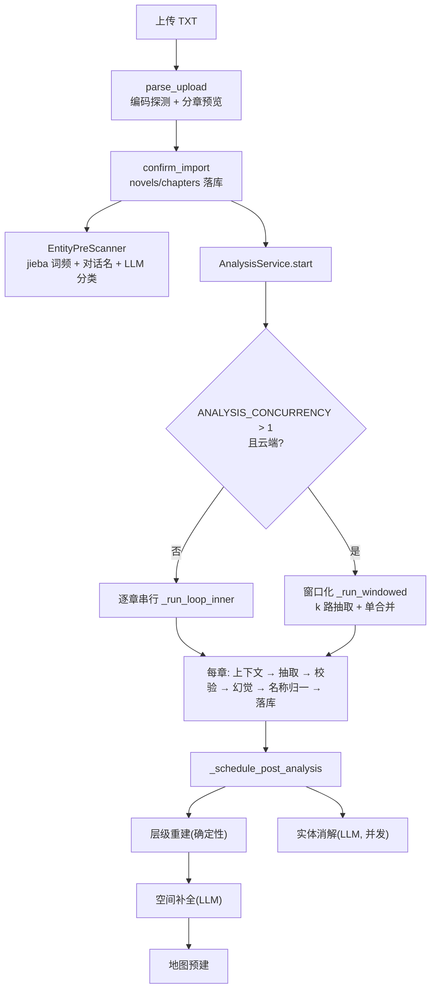

# 04 · 分析流水线

## 一句话概括

整条链路是**"先切书、再扫实体、逐章抽取事实、规则+LLM 双重校验、最后串行跑确定性地理链"**。单章失败不阻塞整本，跑完自动重试；云端并发达 `ANALYSIS_CONCURRENCY>1` 时走"窗口化并发"——并行只做无副作用的 LLM 计算，所有状态变更按章号串行合并。

## 全景



## 1. 摄入：分章与入库

### 上传与预览

`POST /api/novels/upload` → `novel_service.parse_upload()`（`v0.85.0`：265 行）：

1. 读取字节，计算 `file_hash`（SHA256），做**编码探测**（UTF-8 / GBK 等）；
2. 用 `utils/chapter_splitter.split_chapters_ex()` 分章，返回 `SplitResult`；
3. `_compute_diagnosis()` 给出切分质量诊断（章节数、字数分布、是否疑似切错）；
4. `_build_preview()` 生成章节列表 + 字数 + 首章片段，返回给前端；
5. 原始内容与切分结果放进进程内 `_upload_cache`（带 TTL，`_evict_expired`），**不落库**。

### 分章器

`backend/src/utils/chapter_splitter.py` 是纯正则 + 启发式的多模式切分器：

| 模式 | 匹配对象 |
| --- | --- |
| `chapter_zh` | `第X章`、`番外X`、`楔子/引子/序言/后记/尾声/完本感言`；支持"第X部 副标题 第X章"前缀 |
| `section_zh` | `第X回/节/卷/幕/场/部`、`卷X`、`(第X卷)`、`一　标题`、结构标记 |
| `cn_numbered` | `一、`、`十二、`、`一百二十三、` |
| `numbered` | `1.`、`001 标题`、`1、标题` |
| `chapter_en` | `Chapter 1` 等英文模式 |
| `markdown` | `# 标题` 层级 |
| `separator` | `***` / `---` 分隔符 |
| `heuristic_title` | 无编号，按短行 + 无句末标点判定标题 |
| `fixed_size` | 兜底，按 8000 字切块 |

细节：中文数字支持 `零〇一二两三四五六七八九十百千万`（"第两千章"）；`[^\S\n]` 防止跨行误匹配；超过 50,000 字的章节会被二次切分；`heuristic_title` 用 `_BODY_PUNCTUATION` 排除正文短句；URL 混淆文本会被过滤。

导入后用户可以在预览里**排除章节**（`excluded_chapters`）并改书名/作者；`confirm_import()` 在单个事务里写 `novels` + `chapters`，失败回滚，然后把上传缓存删掉，并**后台触发预扫描**。

### 重新切分

`re_split` / `infer_and_resplit` / `clean_and_resplit` 三个接口覆盖"模式选错、需要重切"的场景；`clean_and_resplit` 会先清洗广告/乱码行。`append_chapters` 支持连载追更，用 `_chapter_fingerprint(title, content)` 去重。

## 2. 预扫描：先建实体词典

`extraction/entity_pre_scanner.py`，产物写 `entity_dictionary`，状态写 `novels.prescan_status`：

1. **Phase 1 规则扫描**（无 LLM）：
   - `_scan_word_freq` + jieba 分词；
   - `_scan_ngrams` 找 2–4 字高频片段，`_dedup_ngrams` 去掉被长名包含的短名；
   - `_extract_dialogue_names`：`“……”` 前后的话术模式（`说道/问道/笑道`）抓说话人；
   - `_extract_title_words`：章节标题里的高频词；
   - `_extract_naming_patterns` + `_match_suffix_patterns`：姓氏/称谓后缀；
   - `_merge_candidates` 合并投票，保留 `sample_context`。
2. **Phase 2 LLM 分类**：`_classify_with_llm` 只判"候选是什么类型"（person/location/org/item/concept），`_merge_llm_results` 合并；LLM 失败则整段降级为规则结果，不阻塞分析。

词典的用途贯穿全链路：

- 抽取时作为**上下文提示**（`ContextSummaryBuilder._build_dictionary_section`）；
- 作为**名称纠错表**（`二愣子` 被 LLM 抽成 `愣子` 时反向修正，`analysis_service.py:461-491`）；
- 作为**幻觉审查白名单**（词典里的真实人物永不被判为幻觉）；
- 作为 `NameResolver` 的初始别名映射。

`start()` 前的 `_ensure_prescan()`：`pending` 同步跑；`running` 最多等 120s；`failed` 记 warn 后无词典继续；`completed` 直接跳过。`force=True` 重跑时不强制预扫描。

## 3. 单章抽取（核心）

### 3.1 上下文构建

`extraction/context_summary_builder.py` 的 `ContextSummaryBuilder.build()` 只使用**章号小于当前章**的 facts（并发时自动排除在飞章节），拼出：

| 段落 | 方法 | 内容 |
| --- | --- | --- |
| 人物聚合 | `_aggregate_characters` | 已出现人物 + 别名 + 最近状态 |
| 关系聚合 | `_aggregate_relationships` | 已有关系及其类型 |
| 地点聚合 | `_aggregate_locations` | 地点 + 层级链 |
| 物品聚合 | `_aggregate_items` | 物品流转 |
| 场景焦点 | `_build_scene_focus_section` | 上一章结尾场景 |
| 宏观枢纽 | `_build_macro_hub_section` | 高频核心地点 |
| 上行链 | `_build_upward_chain` + `_format_hierarchy_chains` | 当前地点到根的路径 |
| 地理状态 | `_build_geo_state_section` | 已确立的方位/距离约束 |
| 世界结构 | `_build_world_structure_section` | 图层、传送门、类型提示 |
| 实体词典 | `_build_dictionary_section` | 预扫描词典节选 |

### 3.2 提示词组装与预算

`ChapterFactExtractor.extract()`（`chapter_fact_extractor.py:993`）：

1. 按 `novel_genre_hint` 注入题材片段（`_GENRE_CONTEXT`）；
2. 替换 `{context}` 为上下文摘要；
3. 按开关注入三份**可选指南**，每份都要求把标记字符串替换掉，找不到就 warn：
   - `VOT_SPATIAL_ENABLED` → `## 空间关系提取规则` 前插入 VoT 指南；上下文窗口 ≤8192 时跳过，且注入后从章节长度预算里扣除指南长度（`effective_max_len`）；
   - `RELATION_DIMENSIONS_ENABLED` → `## 地点提取规则` 前插入关系维度指南；
   - `EVIDENCE_GROUNDING_ENABLED` → 同位置插入证据锚定指南。
   **关闭开关时 prompt 与 v0.73 行为一致（NFR-3）**，这是刻意的可回归设计。
4. 超长章节按 `budget.max_chapter_len` 截断，记 `meta.is_truncated`；
5. `budget.segment_enabled` 时按 `_split_chapter_text` 分段，逐段抽取后 `_extract_segmented` 合并，记 `segment_count`；
6. 云端 + 单段 + 未截断时，把**场景抽取并入主抽取**（issue #78）；分段/截断章走独立 `scene_llm_extractor`，避免 `paragraph_range` 坐标系被破坏；
7. `_call_with_overflow_shrink`：遇到上下文溢出，逐步缩短输入重试；
8. `_call_and_parse`：JSON 解析失败按 `ExtractionError` 处理，可重试错误（`_is_transient_error`）会重试；
9. 可选 **recall pass**：`_recall_pass` 针对首遍可能漏掉的人物/事件做一次补漏，产出项标记 `source="recall_pass"`；
10. 可选 **关系子类型自一致性投票**：`_vote_rel_subtypes` 多次采样，`subtype_vote` 记录票型。

### 3.3 规则校验

`extraction/fact_validator.py`（2059 行）在落库前做确定性清洗：

- 用**原文**做证据锚定：`validate(fact, chapter_text=...)` 会给缺 evidence 的人物补锚点，证据找不到的条目按规则软剔除；
- 关系维度约束（`polarity/rel_subtype/closeness` 的合法枚举）；
- 地点 `type/parent/role` 规范化；
- 组织事件、物品事件的动作枚举与空证据处理；
- 名称纠错表（数字前缀）在此生效；
- 题材相关的合理性检查（如 `novel_genre_hint`）。

### 3.4 幻觉审查（可选 LLM 层）

`_review_hallucinations()`（`analysis_service.py:180`）在规则层之后、落库之前：

- 输入：本章 fact + 原文 + `_protected_names`（词典实体 + 本次运行已确立人物）；
- 输出：剔除/降权疑似幻觉人物，避免"LLM 编造角色"进入图谱；
- 已确立人物加入白名单后**后续章节不再判定**，防止真实人物被误杀；
- 开关：`HALLUCINATION_REVIEW_ENABLED`。

### 3.5 名称归一

`extraction/name_resolver.py`：

- `load_from_entity_dictionary()` 预载别名；
- `resolve(fact)` 把本章的 `行者/美猴王` 统一成 `孙悟空`；
- `accumulate_from_chapter(fact, chapter_text=...)` 做**双向原文锚定**——别名与 canonical 都必须在原文出现过才进入映射，避免"模型自造别名"扩散。

### 3.6 落库与章内并行

`insert_chapter_fact()` 先写（`INSERT OR REPLACE` 保证行存在），随后三个互不依赖的副作用用 `asyncio.gather(return_exceptions=True)` 并行：

| 任务 | 说明 |
| --- | --- |
| `_update_world_structure` | `WorldStructureAgent.process_chapter`，更新图层/区域/传送门 |
| `_extract_and_store_scenes` | 场景切分与入库（有并入结果则直接用） |
| `_index_chapter_embeddings` | 写 Chroma `chapters` / `entities` collection |

顺序约束写在注释里：场景 UPDATE 依赖 INSERT 的行已存在；embedding 只吃 fact+原文；幻觉判定必须先完成才能落库。任一子任务失败只记日志，不阻塞管线；`CancelledError` 继续向上抛。

最后：`update_chapter_analysis_status("completed")` → `invalidate_layout_cache()` → 累计 stats → 广播 `chapter_done`。

## 4. 串行 vs 窗口化并发

### 串行（默认，`k=1` 或本地 Ollama）

`_run_loop_inner()` 按章号顺序执行上述全部环节，每章开头广播 `processing`，每个阶段广播 `stage`（`构建上下文` / `AI 提取中` / `验证数据` / `保存数据` / `场景分析 · 世界结构更新`），结束广播 `chapter_done`。

### 窗口化（`ANALYSIS_CONCURRENCY>1` 且 `LLM_PROVIDER=openai`）

`_run_windowed()`（`analysis_service.py:1074`）的设计要点：

```
dispatcher（按章号投喂） → k 个 worker（构建上下文 + LLM 抽取，纯计算）
                          → merger（按章号缓冲，串行执行全部副作用）
```

- 副作用包括：`FactValidator`、幻觉审查、`NameResolver`、落库、`WorldStructureAgent`、场景、embedding、成本、进度；
- `merge_order` 缓冲保证乱序完成的结果按章号合并，**跨章可变状态读写顺序与串行版一致**；
- 已知权衡：worker 抽第 N 章时只能看到已落库的前序 facts，最多落后 k−1 章；
- 进度按"已解决章数"计数（`done_state` + `counted`），避免窗口内乱序导致进度虚高；
- 暂停/取消：dispatcher 停止投喂，在飞抽取完成后排空即停；若 `resume` 在排空期间抢跑，本轮结束后从头重扫（`force=False` 自动跳过已完成章），避免卡在 `running`。

`config.get_analysis_concurrency()` 只对云端 provider 返回 >1，本地 Ollama 强制串行，上限 3（`infra/config.py:125-139`）。

## 5. 错误、重试与恢复

| 场景 | 处理 |
| --- | --- |
| `ExtractionError`（JSON 解析失败等） | 章节标 `failed`，`error_type=parse_error`，继续下一章 |
| 其他异常 | `_classify_error()` 按异常类型归为 `timeout` / `content_policy` / `http_error` / `unknown`，同样只标记本章 |
| 本轮到尾仍有失败 | **自动重试一次**（`_failed_in_run`）：重跑上下文 → 抽取 → 落库，成功广播 `chapter_done: retry_success`；`content_policy` 章节直接跳过（重试必然再被拒） |
| 仍失败 | 保留 `failed` + 最新 `error_type/error_msg`；用户可点"重试失败章节"走 `retry_failed_chapters()` 后台重跑，广播 `retry_start/retry_progress/retry_done` |
| 进程重启 | lifespan `recover_stale_tasks()`：任务 `running → paused`，可 `resume` |
| 暂停 | 当前章跑完才停，DB 与广播立即更新为 `paused` |
| 取消 | 同暂停，状态 `cancelled` |

重试不是无限循环：`retry_failed_chapters` 只挑 `analysis_status='failed'` 的行，成功后清 `error_msg`，再次失败保留最新错误。

## 6. 分析完成后链

分析结束（状态置 `completed` / `completed_with_errors` 之前）还有两段**同步**后处理，然后才是**后台**派生链。

### 6.1 地点层级优化（同步，非致命）

`analysis_service.py:940-997`：

1. `SceneTransitionAnalyzer` 从全部场景提取场景间的地点转移作为投票，`world_agent.inject_external_votes`；
2. 若孤儿根节点 ≥3，用 `LocationHierarchyReviewer` 做一次 **LLM 层级复核**（`Timeout=60s`，超时只 warning 并跳过）；
3. `world_agent._resolve_parents()` + `consolidate_hierarchy()` 合并投票与层级，`world_structure_store.save()`。

整段包在 try/except 里，失败只记 warning，不影响任务状态。

### 6.2 简介生成（同步，非致命）

`analysis_service.py:999-1051`：若 `novels.synopsis` 为空，从 facts 里取高/中重要度事件 + 前 20 人物 + 前 15 地点，交 `SynopsisGenerator`（`Timeout=120s`）生成简介写回 `novels`。超时/失败只 warning。

### 6.3 后台派生链（`_schedule_post_analysis`）

`analysis_service.py:1582` 开两个后台任务：

1. **geo 链（串行）** `_run_geo_pipeline`（`analysis_service.py:1604`）：
   - `_auto_rebuild_hierarchy`：`build_default_orchestrator` 的确定性管线，无 LLM、<1s；
   - `_auto_spatial_completion`：`SpatialCompletionAgent`，LLM，`wait_for(timeout=300)`；
   - `_auto_map_prebuild`：先 `invalidate_map_response_cache()`，再 `get_map_data(1, total)` 预热海陆/河流/道路，写 `map_geo_artifacts`；广播 `map_prebuild: running/done/error`。
   **必须串行**的原因写在 docstring：后两步都对 `world_structures` 做整文档 load-modify-save，并发会产生 last-writer-wins；实测曾把西游的层级覆盖回旧版本（`roots=332` 失真）。
2. **实体消解（并发）** `_auto_entity_resolution`：`entity_resolver.resolve_novel()`，只写 `entity_overrides` / 词典，不动 `world_structures`，因此可与 geo 链并行。

## 7. 二审（source pass）：独立的第二遍

`services/source_pass_service.py` 是一个**影子分析器**，用数据路径保证独立性：

- 上下文只由原文 + **本 pass 前序 facts**（`pass_chapter_facts`）+ 预扫描词典构成，机制上读不到主表与 `world_structures`；
- 跳过幻觉审查、世界结构更新、场景、向量索引、全部后处理；
- 产物只写 `analysis_passes` / `pass_chapter_facts`；
- 与一审**互斥**：任一方运行中，另一方拒绝启动（双向检查）；
- 消息类型用 `pass_*` 前缀（`pass_progress/pass_processing/pass_chapter_done/pass_status`），复用同一 `/ws/analysis/{novel_id}` 频道，消息里带 `pass_id`；
- 支持 `model_override`：浅拷贝现 client 只换 model，得到"第二个模型视角"；
- `history_json` 记录暂停/恢复/失败历史，`recover_stale_passes` 在重启后统一 `running → paused`。

二审的用途是对比两遍结果的差异（漏抽/多抽），不是替换主数据；`routes/analysis_passes.py` + `pass_diff` 相关服务负责展示差异。
