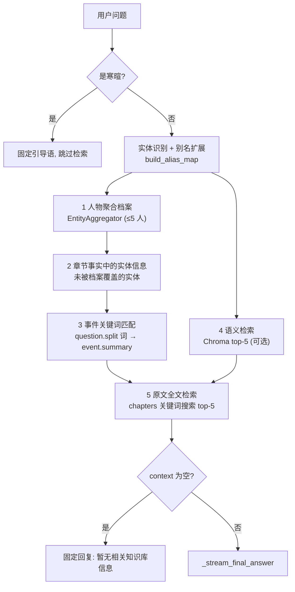

# 07 · 查询、RAG 与读模型

## 一句话概括

问答全文**只有一条收尾管线**（`_stream_final_answer`），前面接两种检索策略：默认 **RAG 五路召回**；在云端 provider 下设置 `QA_MODE=agent` 后改为 **最多 4 轮工具调用取证的 Agent**。两者都负责"把证据塞进 prompt"，回答与落库共用同一段代码——保证模式不改变引用格式与历史行为。

## 两种问答模式

| 模式 | 入口 | 特点 |
| --- | --- | --- |
| `rag`（默认） | `query_service.query_stream()` | 一次检索、一次生成，延迟低、成本低 |
| `agent` | `agent_qa_service.agent_query_stream()` | 模型自选工具多次取证，证据更全，成本与延迟高 |

模式由环境变量 `QA_MODE` 决定（`config.py:32`，默认 `rag`）；`query_stream` 里 `QA_MODE == "agent"` 且非 Ollama 时才进入 Agent，本地 Ollama 自动回退 `rag`。**Agent 失败也会回退到 RAG**。当前没有前端开关，切换需重启进程并改环境变量。

## RAG 五路召回

`query_stream()`（`query_service.py:470`）按固定顺序拼 context，每块都受字符预算截断：

### 各路的实现要点

| # | 召回 | 实现 | 预算 |
| --- | --- | --- | --- |
| 1 | 人物聚合档案 | `_build_profile_context()`：`aggregate_person` 取别名、按 6 类（family/intimate/hierarchical/social/hostile/other）分组的关系、能力；每人一块，最多 5 人 | `max_chars=4000` 总预算 |
| 2 | 实体信息 | `_build_entity_context(all_facts, remaining)`：从原始 facts 里按实体名匹配（已被档案覆盖的跳过） | 内部截断 |
| 3 | 事件关键词 | `_build_keyword_context()`：把问题按空格切成 ≥2 字的词（无词则用整句），匹配 `events.summary` | `max_chars=2000` |
| 4 | 语义 | `embedding_service.search_chapters()`：Chroma cosine top-5，每段截前 200 字，跳过已命中的章 | 片段截断 |
| 5 | 原文 | `_build_text_context()`：`chapter_store.search_chapters()` 对前 3 个关键词各取 top-5 章节，输出带 `snippet` 的片段 | 每关键词 5 章 |

空结果时**不调用 LLM**，直接回固定文案——注释写明理由：空上下文会诱发幻觉（issue #56 症状 1/3）。

关键设计：

- **问题感知的关系过滤**：`_detect_relation_filter(question)` 把"师父/夫妻/仇人"等词映射到关系类型关键词（`query_service.py:223-231`），命中时**跨全部阶段**扫描而不是只看最近状态，避免"现在关系变了就答不出过往"。
- **别名归一**：召回前用 `build_alias_map()` 扩展实体名池，用户问"大圣"也能命中"孙悟空"的档案。
- **语义检索是可选增强**：`chromadb` 缺失时 `embedding_service` 抛可操作提示，`query_service` 记 **warning 日志**后跳过（注释特别强调：用 debug 级别会让"为什么没有语义召回"永远查不出来）。
- **重复章节去重**：`all_source_chapters` 是 set，最终与答案里解析出的"第X章"合并。

### 收尾管线

`_stream_final_answer()`（`query_service.py:401`）：

1. 取最近 6 条历史（`conversation_store.get_recent_messages`），拼成 `history`；
2. `_QA_SYSTEM_PROMPT.format(context=…, history=…)`；
3. `llm.generate_stream(timeout=180)` 逐 token yield `{"type":"token"}`；
4. 流式异常**不中断连接**，改为输出一句道歉文本（并写入历史），前端体验优先；
5. 用正则从答案里抽 `第(\d+)章` → 与检索来源合并 → `{"type":"sources"}` → `{"type":"done"}`；
6. 若有会话，落库 user/assistant 两条消息（`sources_json` 存章节数组）。

"引用"不是装饰：`sources` 同时来自**检索命中**和**答案自述**，两者取并集，因此模型若提到未召回的章节也能被记录。

## Agent 问答

`agent_qa_service.py`：

| 项 | 值 |
| --- | --- |
| 最大迭代 | `MAX_ITER = 4` |
| 工具数 | 3 |
| 系统提示 | 明确"你负责取证，不负责回答" |

| 工具 | 参数 | 后端实现 |
| --- | --- | --- |
| `get_entity_profile` | `name` | 依次尝试 person → location → item → org 聚合，返回约 2000 字档案 |
| `search_text` | `keyword` | 复用 `_build_keyword_context`，返回命中章节与片段 |
| `get_chapter_excerpt` | `chapter_num` | 该章事件摘要 + 原文片段 |

循环（`agent_query_stream`）：模型返回 tool_calls → `_execute_tool` 执行 → 结果作为 observation 回灌 → 直到模型不再调工具或达 `MAX_ITER`。过程中 yield `{"type":"status"}`（如"正在查证「孙悟空」的档案…"，由 `_status_text` 生成），最后调用共享的 `_stream_final_answer`。

工具本身抛异常时**不中断**，异常文本作为 observation 回灌，让模型自行换策略——`tests/test_agent_qa.py` 有专门用例守护（`test_agent_tool_failure_fed_back_as_observation`）。

Provider 中立：`TOOLS` 是自研 schema，`generate_with_tools` 内部按 provider 包装成 OpenAI `tools` / Anthropic `tool_use`。

## WebSocket 协议

`/ws/chat/{session_id}?token=…`（`api/websocket/chat_ws.py`）：

| 方向 | 消息 | 说明 |
| --- | --- | --- |
| → 服务端 | `{"novel_id": "...", "question": "...", "conversation_id": "..."}` | 一次请求一条；会话 id 可为 null |
| ← 客户端 | `{"type":"token","content":"..."}` | 流式正文 |
| ← 客户端 | `{"type":"status","content":"..."}` | Agent 工具调用状态 |
| ← 客户端 | `{"type":"sources","chapters":[1,3,5]}` | 引用章节 |
| ← 客户端 | `{"type":"done"}` | 结束标记 |
| ← 客户端 | `{"type":"error","message":"..."}` | JSON 非法、缺字段或流式异常 |

问答只有这一个 WS 入口，没有非流式 REST 版本；HTTP 只负责会话 CRUD。

## 会话管理 REST

`routes/chat.py`：列/建/删会话、拉消息（默认 100 条）、导出单会话、导出全书所有会话（Markdown）。导出走 `_format_conversation_markdown`，包含问答与引用章节。

## 其他读模型

以下都在请求时聚合，不落库（`visualization_service` / `encyclopedia_service` / `series_bible_service` / `conflict_detector`）：

| 读模型 | 入口 | 内容 |
| --- | --- | --- |
| 关系图 | `get_graph_data(novel_id)` | 节点（人物/地点/组织/物品，带类型、权重、出现章节）+ 边（关系类型、分类、证据、首末章）；前端力导向渲染 |
| 时间线 | `get_timeline_data(novel_id)` | 事件按章号排序，带参与者、地点、重要度、类型；支持按人物/地点过滤 |
| 势力 | `get_factions_data(novel_id)` | 组织成员、组织间关系、势力消长 |
| 百科 | `encyclopedia_service.get_encyclopedia_entries()` | 概念/地点/物品/组织词条，`_sort_by_hierarchy` 按层级排序；`get_concept_detail`、`get_location_spatial_summary`、`get_entity_scenes`、`get_location_conflicts_summary` |
| 场景 | `_extract_and_store_scenes` 产物 | 场景边界、参与者、`paragraph_range`，用于阅读页高亮与"场景跳转" |
| 冲突 | `conflict_detector` | 地点归属冲突、层级冲突、关系冲突，供地图/百科提示 |
| 系列圣经 | `series_bible_service.collect_data()` + `series_bible_renderer` | **单本书**的设定集/资料集：模块 `characters`/`relations`/`locations`/`items`/`orgs`/`timeline`，模板 `complete`（通用）/`author`（网文作者套件），导出 markdown/docx/xlsx/pdf |

所有读模型共享两条纪律：

1. **用户覆盖优先**：`entity_overrides` / `world_structure_overrides` / `map_user_overrides` 在组装最后一步叠加；
2. **别名统一**：先 `build_alias_map()` 归一再聚合，避免同一人分裂成多个节点。

## 性能特征

- `EntityAggregator` 有进程内 LRU（按 `(novel_id, kind, name)`），facts 变更时 `invalidate_cache`。
- 全量 facts 读取用 `_load_chapter_facts()`，按 `chapter_id` 排序后逐章流式读取，不做全表驻留。
- Chroma 查询按 `novel_id` 隔离 collection，无跨书污染。
- 问答的历史只取 6 条，避免长会话把 prompt 撑爆。
