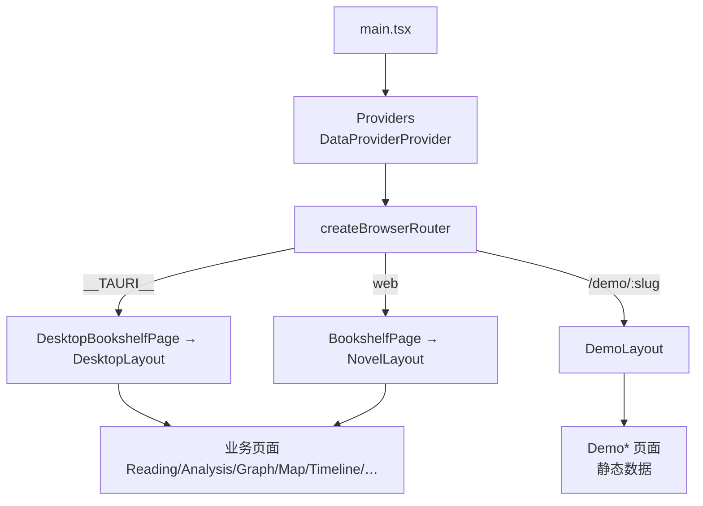

# 08 · 前端架构

## 一句话概括

前端是**一个 SPA、两套路由、三种运行形态**：同一批业务页面在 Web（REST 直连）、桌面（sidecar + 鉴权）、Demo（静态 JSON.gz）三种形态下复用；差异收敛在 `router.tsx` 的平台分支、`api/client.ts` 的 base URL 与鉴权头、`stores/` 的 WS URL 拼接，以及 Demo 专属的 `DemoContext` 数据适配器。

> 注意：`providers/` 下的 `NovelDataProvider` 三实现（Api/Desktop/Demo）在当前代码中是**未被页面消费的抽象**——`useDataProvider` 除了自身定义外没有任何调用点，生产页面直接调用 `api/client.ts`，Demo 页面走 `DemoContext` + `demoDataAdapter`。见文末"前端已知问题"。

## 应用骨架



- 所有页面 `lazy()` 加载，外层 `SuspenseWrapper` 统一骨架屏；`DemoErrorBoundary` 只挂在 Demo 路由。
- `app/providers.tsx` 挂 `DataProviderProvider`，但业务页面并不消费它（历史抽象，见文末）。
- 页面直接调用 `api/client.ts` 的具名函数（如 `fetchNovels`、`fetchChapters`）；只有 Demo 页面通过 `DemoContext` 读取预加载数据包。

## 路由矩阵

| 形态 | 书架 | 小说内页前缀 | 布局 |
| --- | --- | --- | --- |
| 桌面 | `/` | `/novel/:novelId/{analysis,reading,graph,map,timeline,encyclopedia,factions,chat,conflicts,export}` | `DesktopLayout`（顶部 Tab） |
| Web | `/` | `/{analysis,read,graph,map,timeline,factions,encyclopedia,chat,conflicts,export}/:novelId` | `NovelLayout`（侧边栏） |
| Demo | `/demo/:novelSlug` | `{reading,graph,map,timeline,encyclopedia,factions,export}` | `DemoLayout` |
| 设置 | `/settings` | — | 独立页 |

细节：

- 桌面内页 index 重定向到 `reading`；`encyclopedia/*` 用通配支持词条子路由。
- `/demo` 裸路径重定向到 `/demo/honglou/reading`（内置示例）。
- 平台判断在模块级完成（`isTauri` 常量），因为 `createBrowserRouter` 需要在渲染前确定路由表。
- 桌面路由**不包含** `ScreenplayPage`/`StorylineView` 等实验页，Web 侧的页面清单以 `pages/` 为准（`ScreenplayPage.tsx` 为剧本视图实验）。

## 数据源现状

`providers/types.ts:45-83` 定义了 `NovelDataProvider`（12 个方法：小说列表、章节、正文、图谱、地图、时间线、百科、势力、世界结构、实体档案等），并有三个实现：

| 实现 | 设计意图 | 实际使用 |
| --- | --- | --- |
| `ApiDataProvider` | 包装 `api/client.ts` | **无调用点** |
| `DesktopDataProvider` | Tauri `invoke` 读 bundle/import 的 `json.gz` | **无调用点**（桌面页直接调 client + invoke） |
| `DemoDataProvider` | CDN 静态 `json.gz` | **无调用点**（Demo 走 `DemoContext`） |

当前真实的三条数据路径：

| 形态 | 数据入口 | 实现 |
| --- | --- | --- |
| Web / 桌面业务页 | `api/client.ts` → `/api/*` 或 sidecar | 直接 fetch + Bearer token |
| 桌面书架/导入 | `@tauri-apps/api/core.invoke` | `preview_air_file`、`import_air_file`、`load_file_absolute` 等 |
| Demo | `DemoContext` → `api/demoDataAdapter.ts` | `preloadAllDemoData`、`loadDemoChapterContent`、`loadDemoLayerMap` |

`usePlatform()` 仍被 `DataProviderProvider` 与少量组件用于判断 `isTauri/isDemo`。

## 状态管理

20 个文件（14 个 store + 6 个测试），全部 Zustand `create`：

| Store | 职责 | 关键状态 |
| --- | --- | --- |
| `novelStore` | 小说列表与当前小说 | `novels`、`currentNovel`、加载状态 |
| `analysisStore` | **分析进度核心**：WS 连接、进度、阶段、成本、失败章节、地图预建状态 | `progress`、`stageLabel`、`costStats`、`failedChapters`、`mapPrebuildStatus` |
| `chapterRangeStore` | 全局"章节范围"筛选（图谱/地图/时间线共用） | `start/end`、预设范围 |
| `readingStore` | 阅读进度与章节内容缓存 | `currentChapter`、滚动位置、`entities` |
| `readingSettingsStore` | 阅读排版偏好（字号/行距/主题），持久化到 localStorage | — |
| `chatStore` | 会话列表、消息流、流式 token、引用来源 | `messages`、`isStreaming`、`status` |
| `passStore` | 二审 pass 的进度与状态（独立于主分析） | `passId`、`passStatus` |
| `mapDataStore` | 地图数据、当前图层、缓存与失效 | `mapData`、`activeLayer` |
| `timelineStore` | 时间线数据与人物筛选 | `events`、`filter` |
| `entityCardStore` | 实体详情抽屉（全局单例） | `open`、`entityName/type` |
| `visualizationFocusStore` | 跨页聚焦（从图谱点地点跳地图） | `focusedName` |
| `llmInfoStore` | 当前模型/provider/上下文档位 | `model`、`provider` |
| `themeStore` | 明暗主题 | `theme` |
| `tourStore` | 新手引导步骤 | `step` |

持久化策略：只有阅读偏好、主题、章节范围等"用户偏好"写 `localStorage`；分析进度、地图数据等**不持久化**，页面刷新后通过 REST 拉一次最新任务（`getLatestAnalysisTask`）再重连 WS。

## WebSocket 的两处接入

### 分析进度（`analysisStore.connectWs`）

- URL：桌面 `getSidecarWsUrl() + /ws/analysis/{novelId} + sidecarWsQuery()`；Web 用 `location.host` 推导 ws/wss。
- **重连**：最多 5 次，指数退避（1s 起）。用 `_connGen` **代数号**做代际隔离——旧连接的 `onclose/onmessage` 不能影响新连接，防"切书后旧进度串台"。
- **双重校验**：连接代数 + 消息里的 `novel_id` 必须与当前一致，否则丢弃。
- **消息类型**（`AnalysisWsMessage`）：`stage`（阶段标签 + 模型/provider）、`progress`（章号/总数/统计/成本/耗时）、`processing`、`chapter_done`、`retry_start` / `retry_progress` / `retry_done`、`map_prebuild`、`task_status`；二审另有 `pass_progress` / `pass_status`（由 `passStore` 处理）。
- `mapPrebuildStatus` 在 done/error 后 **5 秒自动清除**，避免横幅常驻。
- 组件卸载只关连接，不清缓存；重新进入靠 `getLatestAnalysisTask` 恢复。

### 聊天（`chatStore`）

- URL：桌面 `getSidecarWsUrl() + /ws/chat/{sessionId}`；Web 同理。
- 收到 `token` 追加到当前 assistant 消息；`status` 显示"正在查证…"；`sources` 渲染章节引用 chips；`done` 结束流式态。
- 页面级 `FloatingChatPanel` 可在任意 Tab 唤起，会话与 `ChatPage` 共享 store。

## 页面职责

| 页面 | 规模 | 核心内容 |
| --- | --- | --- |
| `BookshelfPage` | 中等 | 上传（拖拽/选择）、导入预览（分章结果、诊断、排除章节）、书卡、删除 |
| `DesktopBookshelfPage` | 中等 | 桌面书架：预装/导入书目、`.air` 导入、打开小说 |
| `ReadingPage` | 大 | 正文分页/滚动、章节导航、实体高亮（`lib/entityHighlight`）、场景标记、字体设置、进度同步 |
| `AnalysisPage` | 大 | 范围选择、启动/暂停/恢复/取消、实时进度与阶段、成本、失败章节重试、二审 pass 面板 |
| `GraphPage` | 大 | 力导向关系图（`react-force-graph-2d`）、按章节范围过滤、关系类型筛选（6 类）、节点详情抽屉 |
| `MapPage` | 大 | 地图（见 [06](06-geo-and-map.md)）、图层切换、质量面板、地点详情 |
| `TimelinePage` | 中 | 事件时间轴、人物/地点过滤、重要度分级 |
| `EncyclopediaPage` | 大 | 分类词条（人物/地点/物品/组织/概念）、层级排序、词条详情、地点空间摘要与冲突 |
| `FactionsPage` | 中 | 组织卡片、成员、组织间关系 |
| `ChatPage` | 中 | 会话侧栏 + 消息流 + 引用 + Agent 取证状态提示 |
| `ConflictsPage` | 中 | 地点归属、层级、关系冲突清单，可跳转修复 |
| `ExportPage` | 中 | 两套导出：系列圣经（`markdown`/`docx`/`xlsx`/`pdf`，含模板/模块/章节范围/全量开关）与 `.air` 数据包（桌面端走 Rust 保存对话框）；显示进度与落盘路径 |
| `SettingsPage` | 1906 行 | LLM 模式与云预设、API key、模型、预算、数据目录、备份/恢复（质量开关与并发度为环境变量，不在 UI 暴露） |
| `ScreenplayPage` / `StorylineView` | 实验 | 剧本化改写与故事线视图 |

## 可视化组件

| 组件 | 技术 | 用途 |
| --- | --- | --- |
| `NovelMap.tsx`（3518 行） | Canvas/SVG + Leaflet 分支 | 虚构地图主渲染：海陆、河流、道路、区域、标签、交互 |
| `GeoMap.tsx` | Leaflet + `react-leaflet` | 真实地理模式 |
| `GraphPage` 内嵌力导向 | `react-force-graph-2d` | 关系图 |
| `TimelinePage` 内嵌 | 自研虚拟滚动（`@tanstack/react-virtual`） | 时间轴 |
| `MapLayerTabs` / `GeographyPanel` / `MapQualityPanel` / `WorldStructureEditor` | React | 地图控制与审计面板 |
| `components/entity-cards/*` | React | 人物/地点/物品/组织卡片，跨页复用 |
| `components/passes/*` | React | 二审对比视图与进度 |
| `components/chat/*` | React | 浮动问答面板、消息气泡、引用 |
| `components/shared/*` | React | 空态、骨架、错误边界、Toast |
| `components/ui/*` | Radix + CVA | 按钮、对话框、Tabs、Select 等基础件 |

`lib/` 里的渲染工具值得单独列：`coastlineGenerator`（海岸线）、`hullTerritoryGenerator` / `territoryGenerator`（领土轮廓）、`edgeDistortion`（边界扰动）、`labelAnnealing` / `spatialLabels`（标签防重叠）、`terrainHints`（地貌→样式）、`specialSpace`（非地理空间处理）、`paragraphWindow`（阅读分页窗口）、`saveExport`（桌面保存大文件）、`useAuthedAsset`（带 token 取二进制资源）。全部有对应 vitest 用例。

## 构建与运行

| 场景 | 命令 | 行为 |
| --- | --- | --- |
| Web 开发 | `npm run dev` | Vite 5173，`/api` → `localhost:8000`，`/ws` → 同端口 |
| 生产构建 | `npm run build` | `tsc -b` 类型检查 + `vite build` |
| Demo 构建 | `npm run build:demo` | 注入 demo 标志，产出静态站点 |
| 桌面开发 | `npm run tauri dev` | Tauri 读 `src-tauri`，WebView 加载 dev server |
| 桌面打包 | `npm run build:desktop` | 先 `npm run build`，再 `tauri build`，打包 `ai-reader-sidecar` |

TypeScript 用多 project 引用（`tsconfig.json` + `tsconfig.app.json` + `tsconfig.node.json`），路径别名 `@/` 指向 `src/`。ESLint 9 flat config + `typescript-eslint` + `react-hooks` + `react-refresh`，对"hook 与 Provider 同文件"有显式豁免注释（`context.tsx:19`），说明规则被当作纪律而非教条。

## 前端侧代码地图

```
frontend/src/
├── api/          client.ts（统一 fetch）、sidecarBridge.ts（端口/token）、types.ts（全部契约）
├── app/          router / 三套 Layout / Providers
├── providers/    NovelDataProvider 三实现 + context + dataUtils
├── stores/       14 个 Zustand store
├── pages/        14 个页面 + demo/ 7 个静态页
├── components/   ui / shared / visualization / entity-cards / chat / passes
├── desktop/      桌面书架等桌面专属页
├── hooks/        usePlatform 等
└── lib/          地图渲染、阅读分页、导出、工具
```

## 前端已知问题

1. `NovelMap.tsx`（3518 行）与 `SettingsPage.tsx`（1906 行）超大，改一处需通读上下文。
2. **`providers/` 数据源抽象已失活**：三实现齐全、接口完备，但零调用点；实际数据路径分裂为 `api/client.ts`、Tauri `invoke`、`DemoContext` 三套。这既是死代码，也是"新增数据字段要改多处"的根因。
3. Demo 页面是平行实现（`pages/demo/*`），功能演进要同步两份。
4. WebSocket 重连只重试 5 次；超过后需用户手动刷新（设计取舍：避免后台无限重连）。
5. `api/types.ts` 手工维护后端契约，`Record<string, unknown>` 兜底让类型漂移不易被 `tsc` 发现。
