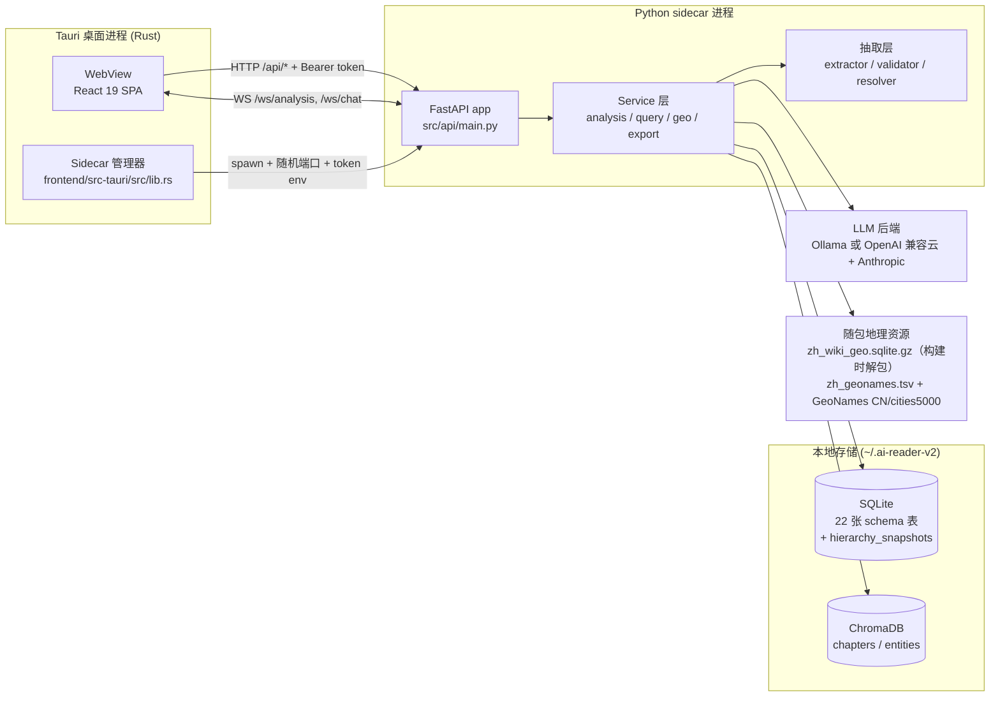

# AI Reader V2 架构文档

本目录记录 `_research/AI-Reader-V2`（下称 V2）的架构分析结果。分析方式：**codegraph MCP 索引遍历 + 源码逐文件核对**，基线与仓库版本 `0.85.0` 一致，未执行任何编译或构建。

## 一句话概括

V2 是**本地优先的"小说 → 结构化知识库"工具**：Tauri 2 桌面壳拉起一个 PyInstaller 打包的 Python sidecar（FastAPI），把整本小说逐章抽取为 `ChapterFact`，再离线派生为关系图、世界地图、时间线、百科、势力与可溯源问答；所有数据落在本机 SQLite + Chroma，云端 LLM 只是可替换的推理后端。

## 系统全景



前端只通过 HTTP/WS 契约与后端通信，**没有共享代码层**；桌面版与 Web 版的差异被两件事吸收：sidecar 端口发现 + 请求鉴权头，以及构建期的平台分支路由。Demo 形态另有独立的静态数据适配器（`DemoContext`）。

## 三条主数据流

| 流 | 入口 | 关键产物 | 文档 |
| --- | --- | --- | --- |
| 摄入 | `POST /api/novels/upload` → `confirm_import` | `novels` / `chapters` 行、原始文本选项 | [03](03-data-model-and-storage.md)、[04](04-analysis-pipeline.md) |
| 分析 | `POST /api/analysis/{novel_id}/start` | `chapter_facts`、`world_structures`、`scenes`、embedding、地图产物 | [04](04-analysis-pipeline.md)、[05](05-llm-and-quality-control.md)、[06](06-geo-and-map.md) |
| 消费 | `/api/graph`、`/api/map`、`/api/timeline`、`/ws/chat`、导出 | 读模型（聚合 Profile、布局、图层、时间线） | [07](07-query-and-rag.md)、[08](08-frontend-architecture.md)、[09](09-quality-testing-and-ops.md) |

核心契约只有两个：**`ChapterFact`（每章一份事实）** 和 **`WorldStructure`（全书一份世界结构）**。图谱、地图、时间线、百科都是从它们派生的**读模型**，不反向写回事实。

## 关键架构决策

| # | 决策 | 体现 | 代价 |
| --- | --- | --- | --- |
| 1 | 本地优先：数据默认不出机 | SQLite/Chroma 在 `~/.ai-reader-v2`；云端 key 存 keyring | 无法多端实时同步，靠 `.air` 导出/导入 |
| 2 | 桌面 = Rust 壳 + Python sidecar | `externalBin: binaries/ai-reader-sidecar` | 双进程、双语言、打包链路复杂 |
| 3 | "抽取事实"而非"生成摘要" | `ChapterFact` 必须带原文 evidence span；`fact_validator` 做锚定 | 每章一次大 prompt，成本与时延高 |
| 4 | 质量增强全部可关 | `VOT_SPATIAL_ENABLED`、`RELATION_DIMENSIONS_ENABLED`、`EVIDENCE_GROUNDING_ENABLED` 等开关；关闭后行为与 v0.73 基线一致（NFR-3） | 配置面变多，行为矩阵需要测试矩阵覆盖 |
| 5 | 地理重建是确定性流水线，LLM 只做补全 | `geo_skills/orchestrator.py` 无 LLM 阶段 <1s；`SpatialCompletionAgent` 单独异步 | 地名歧义只能靠 Tier/Prior 规则兜底 |
| 6 | 后台链严格串行 | 分析结束 → 层级重建 → 空间补全 → 地图预建（`_run_geo_pipeline`） | 后两步慢（60–300s），但避免 last-writer-wins 覆盖 |
| 7 | 并发按"窗口"而非按章乱序 | `_run_windowed`：k 路纯计算抽取 + 单合并协程按章序落库 | 只在云端 provider 且 `ANALYSIS_CONCURRENCY>1` 生效 |
| 8 | 前端数据源曾有统一抽象（`NovelDataProvider` 三实现），但**当前已失活**：生产页直连 `api/client.ts`，Demo 走 `DemoContext` | 接口完备但零调用点 | 新增字段需要在 client、types、demo adapter 多处同步 |

## 代码地图

```
AI-Reader-V2/
├── backend/
│   ├── sidecar_entry.py          # 桌面入口：解析 --port，打印 PORT:，启动 uvicorn
│   ├── src/
│   │   ├── api/                  # FastAPI app、23 个 REST 路由模块、2 个 WS 路由
│   │   ├── services/             # 分析编排、问答、地理、可视化、导出、成本…
│   │   ├── extraction/           # 抽取器、校验器、幻觉审查、名称归一、预扫描
│   │   ├── models/               # ChapterFact / WorldStructure / 场景等 Pydantic 模型
│   │   ├── db/                   # 22 张表的 schema 与各 store（+ geo_skills 惰性建的 hierarchy_snapshots）
│   │   ├── infra/                # LLM 客户端、配置开关、上下文预算、密钥
│   │   └── utils/                # 分章、文本、空间与布局工具
│   ├── scripts/                  # 57 个评测/审计/迁移/试跑脚本
│   └── tests/                    # 117 个 pytest 文件
├── frontend/
│   ├── src/                      # React SPA（160 个文件，约 4.4 万行）
│   └── src-tauri/                # 实际生效的桌面壳（v0.85.0，sidecar 名 ai-reader-sidecar）
└── src-tauri/                    # 早期桌面壳（externalBin 名 ai-reader-backend），遗留
```

规模基线（本次实测）：后端 `src` 147 个 Python 文件 / 61,639 行；前端 160 个文件 / 43,753 行 TS+CSS；后端测试文件 117 个、前端 19 个 vitest 测试文件。官方 README 宣称 1764 后端测试 / 112 前端测试。

## 文档索引

| 文档 | 内容 |
| --- | --- |
| [01-tech-stack.md](01-tech-stack.md) | 技术栈、依赖、双 Tauri 工程、工程约定 |
| [02-runtime-and-lifecycle.md](02-runtime-and-lifecycle.md) | 启动链路、sidecar 管理、鉴权、进程与数据目录、任务恢复 |
| [03-data-model-and-storage.md](03-data-model-and-storage.md) | 22 张 schema 表 + 快照表、`ChapterFact`/`WorldStructure` 模型、缓存与迁移 |
| [04-analysis-pipeline.md](04-analysis-pipeline.md) | 上传分章 → 预扫描 → 逐章抽取 → 校验 → 落库 → 后处理链 |
| [05-llm-and-quality-control.md](05-llm-and-quality-control.md) | LLM 抽象、上下文预算、质量开关、成本核算 |
| [06-geo-and-map.md](06-geo-and-map.md) | 层级重建技能流水线、快照版本、地图布局与地理产物 |
| [07-query-and-rag.md](07-query-and-rag.md) | 多路召回、Agent 工具调用、WS 协议 |
| [08-frontend-architecture.md](08-frontend-architecture.md) | 路由、DataProvider、stores、页面与可视化 |
| [09-quality-testing-and-ops.md](09-quality-testing-and-ops.md) | 测试与评测脚本、导出/备份、版本与 CI |

## 已知边界与技术债

- `map_layout_service.py`（6006 行）与 `visualization_service.py`（3579 行）是最大的两个"上帝模块"，地图逻辑（海陆吸附、大陆拆分、约束增强）与响应组装耦合在一个文件里。
- `NovelMap.tsx` 3518 行、`SettingsPage.tsx` 1906 行，前端同样存在超大组件。
- 根目录 `src-tauri/` 与 `frontend/src-tauri/` 并存，sidecar 二进制名、productName、更新器配置都不同；以 `frontend/package.json` 的 `build:desktop` 实际调用的 `frontend/src-tauri` 为准。
- 嵌入依赖拆成 `embed` / `embed-torch` extra：不带 extra 时语义检索不可用，RAG 会降级为"人物档案 + 实体 + 关键词 + 全文"，且异常必须显式打日志（`query_service.py` 中有专门注释）。
- 分析结果带 `is_truncated` / `segment_count` / `output_truncated` 质量标志；超长章节会截断或分段合并，属于已知精度损失点。
