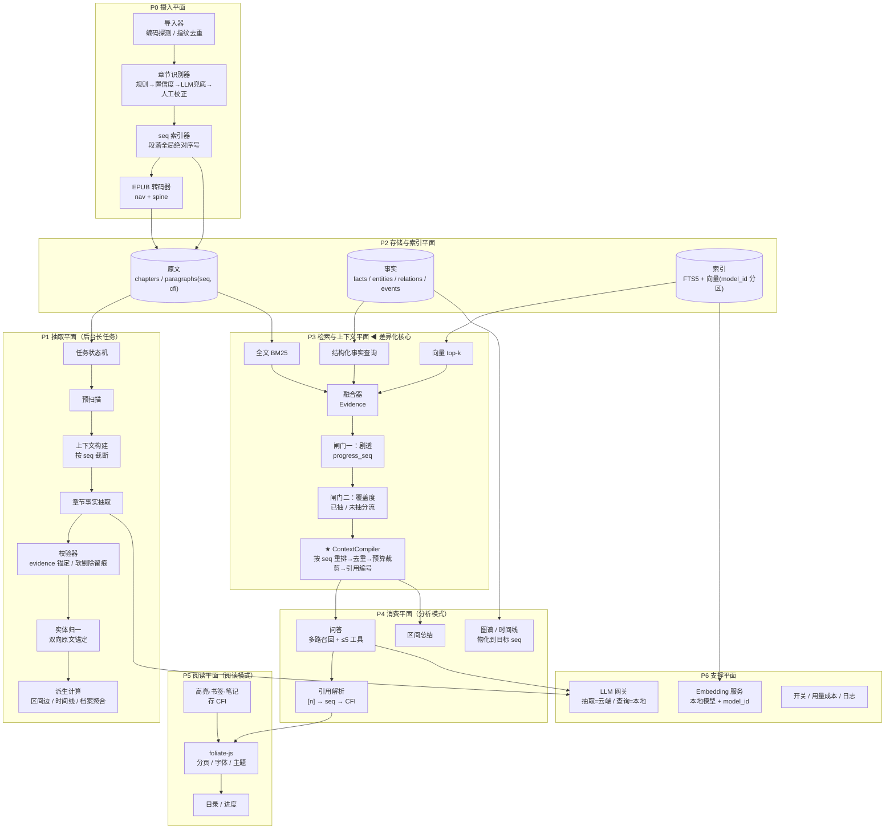

# AI 小说阅读器 · 功能架构

> 本文是 7 轮设计评审收敛后的结果，24 项决策全部有明确取舍。
> 参考样本：`ai-reader-v2/`（知识平面）、`anx-reader/`（阅读平面）、`summary.md`（RAG 路线）、`gihub同类型项目.md`（竞品基线）。
> 本文只描述**功能架构**，不描述 UI。

## 一句话概括

本地优先的「小说 → 可溯源知识库」：Tauri 桌面壳拉起一个可独立运行的本地后端，把整本 TXT 转成内存 EPUB 交给 foliate-js 渲染，同时逐章抽取 `ChapterFact`，派生人物档案、关系图谱与时间线；所有数据落在本机 SQLite（FTS5 + 向量），**所有位置都用「CFI（渲染）+ seq（业务）」双轴表示**，所有 LLM 调用都必须经过唯一的 `ContextCompiler` 出口。

---

## 一、24 项决策

| # | 维度 | 决策 | 主要理由 |
|---|---|---|---|
| 1 | 形态 | Tauri2 壳 + 独立可单跑的本地后端（HTTP + Bearer token） | 后端契约与壳解耦，日后接 Web/移动端不用重写 |
| 2 | AI 定位 | 只做 L2 全书知识库，无 L1 陪伴层 | 避免「两头都做、两头都不深」 |
| 3 | 渲染 | foliate-js（vendored，WebView 内渲染） | 分页/断行/CJK 标点/竖排/CFI 全部现成，自研是纯沉没成本 |
| 4 | 起点 | 完全从零，不 fork 任何存量 | 只抄契约不抄代码，避开 V2 的上帝模块与 Anx 的无向量检索 |
| 5 | 主轴 | 双模式并列：阅读模式 / 分析模式 | 两者状态独立，靠 CFI/seq 打通 |
| 6 | 分析时机 | 导入即后台全量预抽取，**导入后立即解锁** | 不让用户等一次长任务；用覆盖度标注保可信度 |
| 7 | 知识面 | 章节事实+摘要、人物档案+关系图谱、时间线/事件线；百科/势力/地图/二审只留扩展槽 | 地图是 V2 上帝模块（`map_layout_service.py` 6006 行）的来源 |
| 8 | 定位模型 | **双轴：CFI 管渲染位置，seq 管业务排序** | CFI 随排版变、seq 随文本变，二者不能互为权威 |
| 9 | 抽取契约 | 每章一份 `ChapterFact` + evidence span | 章节是小说天然语义边界与增量单位，可并行、可重跑、失败可隔离 |
| 10 | 检索底座 | 自研薄检索层：FTS5 + 向量 + 结构化事实表 | 三类检索一个进程内闭环，省掉 Docker 与一个不听话的排序器 |
| 11 | LLM 供给 | 抽取走云端强模型，查询走本地小模型 | 成本几乎全压在一次性抽取；查询必须零边际成本 |
| 12 | embedding | 索引按 `model_id` 分区，首版只跑本地 | 建库与查询必须同空间；分区让日后接云端无需迁移 |
| 13 | 时序还原 | 独立 `ContextCompiler`，所有 LLM 调用的唯一出口 | 排序与预算裁剪必须同处一地，否则裁剪会让上下文跳着讲 |
| 14 | 问答 | 多路召回为主 + ≤5 个只读工具可选增强 | 本地小模型驾驭不住 15 工具 / 120 轮的 ReAct |
| 15 | 阅读范围 | 笔记/书签/划线 + 目录/进度 + 主题字体；不做 TTS/翻译/同步 | 各自是独立子系统，双模式未跑通前加进去只会拖慢地基 |
| 16 | 章节识别 | 规则优先 + 置信度 → LLM 兜底 → 人工校正 | 小说分章 95% 是格式问题，规则又快又可解释 |
| 17 | 实体归一 | 规则 + 原文锚定双向校验，LLM 只做歧义裁决 | 误合并比不合并难修，且必须可审计 |
| 18 | 任务恢复 | 持久化状态机 + 逐章幂等 + 可暂停恢复 | 几百次 LLM 调用的长任务，进程一关就全丢是不可接受的 |
| 19 | 时态建模 | 区间边 `valid_from_seq` / `valid_to_seq` | 快照随章数线性膨胀；只存最新会丢掉「何时反目」 |
| 20 | 跨书 | 单书为检索单元，书架多本，`book_id` 进所有索引 | 跨书会带来同名人物、跨书年表、跨书剧透边界三重复杂度 |
| 21 | 证据链 | 入库软剔除并记录被拒项；对外展示强制带章节引用 | 硬剔除压垮召回率，不强制则「可溯源」只是道德标签 |
| 22 | 输入管线 | TXT → 内存 EPUB（nav + spine）→ foliate-js | 章节识别产物直接变成目录，避免两套章节逻辑 |
| 23 | 未分析章 | 降级原文检索 + 覆盖度标注 | 直接解锁的唯一可信做法 |
| 24 | 平台 | 首版单平台打透，Linux 后补（需要时换 CEF） | 三个 WebView 引擎三套排版行为，同时调三套必翻车 |

---

## 二、六个功能平面



### P0 摄入平面

| 模块 | 职责 |
|---|---|
| 导入器 | 编码探测（utf8→gbk→latin1→utf16）、换行归一、`sha256` 指纹去重 |
| 章节识别器 | 可扩展规则库（`第X章 / 第十二回 / Chapter N / 楔子 / 尾声 / 番外`），带置信度；低于阈值标记 `needs_llm`，可人工校正 |
| seq 索引器 | 把每章切成**原文精确切片**的段落，分配全书单调递增 `seq`，同时记录段落的 CFI 前缀 |
| EPUB 转码器 | 章节识别结果生成 `nav.xhtml` + `spine`，产出内存 EPUB 供 foliate-js 渲染 |

> **保真约束**：段落必须是章节正文的精确切片（`body[off:off+len(t)] == t`），转码器只能切块与转义，**不得改写任何一个字符**。否则证据高亮会漂。

### P1 抽取平面

`预扫描`（规则抽人名/称谓 → `entity_dictionary`，避免每条都靠 LLM）→ `上下文构建`（前情摘要 + 已建档案 + 关系当前态，**按 seq 截断到当前章**，天然不剧透）→ `逐章抽取 ChapterFact` → `校验`（evidence 必须能命中原文对应段落，否则软剔除并记录）→ `实体归一`（双向原文锚定）→ `派生`（区间边、时间线、章节摘要）。

全部由任务状态机驱动：`queued / running / paused / failed / done`，逐章幂等（同 `chapter_fp` 不重跑）。

### P2 存储与索引平面

原文、事实、索引三块分离；`paragraphs` 表同时承载 `seq` 与 CFI 前缀，**它就是位置映射表本身**；向量表以 `(book_id, seq, model_id)` 为主键；`extensions` 表给百科/势力/地图留槽。

### P3 检索与上下文平面（差异化核心）

三路检索各自返回统一 `Evidence`（带 `seq` + `cfi`）→ 融合去重 → **双闸门**（剧透 `progress_seq` 截断；覆盖度按已抽/未抽分流并打标）→ `ContextCompiler` 按 `seq` 重排、按章节分组裁剪、生成 `[n]` 引用编号。

> **裁剪策略**：以「章节组」为最小保留单元，按得分挑选组，最后再按 `seq` 排序输出。这样可以避免「砍掉中间章导致上下文跳着讲」——这正是把排序与裁剪放在同一模块的原因。

### P4 消费平面（分析模式）

问答（多路召回 + 5 个只读工具：`get_entity_profile` / `search_text` / `get_chapter` / `get_relation_timeline` / `get_events`）、区间总结、图谱与时间线读模型（物化到目标 `seq`，**不反向写事实**）、引用解析。

### P5 阅读平面（阅读模式）

foliate-js 渲染、高亮/书签/笔记（存 CFI）、目录与进度。**双模式桥**：当前阅读位置决定默认 `progress_seq`；在阅读模式选中文本即带上 CFI 进入分析模式提问。

### P6 支撑平面

LLM 网关（抽取/查询双档 provider）、本地 embedding 服务、成本与用量核算、质量开关、日志与评测。

---

## 三、三条关键接缝

1. **`seq` 是业务坐标系，CFI 是渲染坐标系。** 剧透截断只读 `seq`，跳转与高亮只读 CFI，位置翻译的唯一入口是 `paragraphs` 表。
2. **`ContextCompiler` 是唯一出口。** 任何模块想调 LLM，都必须过它；这样排序、裁剪、引用编号永远一致。
3. **`Evidence` 是唯一的证据单元。** 检索、闸门、编译、引用渲染共用同一个结构，中间不允许出现「裸字符串」。

---

## 四、核心契约

| 契约 | 关键字段 |
|---|---|
| `Book` | `id, title, author, source_sha256, chapter_fp` |
| `Chapter` | `idx, title, fp, spine_index, nav_href, char_start, char_end, body, split_source, confidence` |
| `Paragraph` | `seq, chapter_idx, para_idx, char_off, cfi, text` |
| `ChapterFact` | `characters[], relations[], events[], concepts[], summary` + 每条带 `evidence{seq, cfi, text}` |
| `TemporalEdge` | `a_entity, b_entity, rel_type, valid_from_seq, valid_to_seq, version` |
| `Evidence` | `seq, cfi, text, source: fact\|raw, coverage: extracted\|unparsed, score, chapter_idx` |
| `CompiledContext` | `blocks[], citations[], coverage, truncated` |

---

## 五、与三份参考文档的刻意偏离

| 对比 | 文档做法 | 本架构 | 理由 |
|---|---|---|---|
| `summary.md` | RAGFlow / LightRAG + 外部 MCP 胶水层 | 自研薄检索 + 内化 `ContextCompiler` | 保留其核心论点（时序必须自己写），但省掉 Docker 依赖与不可控的排序器 |
| `ai-reader-v2` | 地图/势力/百科/二审/系列圣经，6 万行后端 | 全部只留 `extensions` 槽 | 这些正是上帝模块来源，也是其 star 只有 271 的直接原因 |
| `anx-reader` | foliate-js + 15 工具 Agent + WebDAV 同步 | foliate-js + 5 工具 + 不做同步 | 渲染白拿，Agent 与同步是独立难题 |
| `anx-reader` 定位 | 静态 CFI 为位置真相 | CFI + seq 双轴 | 静态 CFI 在重分章/改排版后集体失效 |

---

## 六、已知风险

1. **`valid_to_seq` 是延迟确定的。** 第 5 章的关系要等第 9 章发现变化才能回填。因此关系表必须 **append-only + version**，禁止 load-modify-save（V2 的 `world_structures` 事故同源）。
2. **`seq ↔ CFI` 映射在重分章下会整体失效。** 靠章节指纹检测内容变化并触发映射重建，旧笔记按指纹就近重锚，而不是静默错位。
3. **TXT→EPUB 转码保真。** 转码若规范化空白，`seq` 对应的原文会与用户看到的位置差几个字符，证据高亮必漂。故转码器只允许切块与 XML 转义。
4. **单平台策略的代价。** 换平台要重调排版与分页行为，Linux 可能需要换 CEF。
5. **覆盖度带来的双链路。** 未抽取章走原文检索，回答质量天然低于事实层，必须显式标注，不能让用户误以为是同等置信度。

---

## 七、实现补充（编码阶段验证后追加）

以下四点是在真机跑《三国演义》（121 章 / 606K 字）后对原设计的修正，均已在代码中落地。

### 7.1 人名识别改用内置 CPU 小模型

原方案只有正则（「X说道」前缀 + 剥尾）。实测在文言小说上召回不足，
改为 **jieba 词性标注 `nr` ∪ 正则**，并保留三档可配置（`ner_backend`）：

| 后端 | 说明 |
|---|---|
| `jieba` | CPU、词典约 5MB；《三国演义》上曹操 934 / 孔明 831 / 玄德 685 |
| `regex` | 零依赖兜底 |
| `auto` | 两者并集（计数取 max，不相加，否则阈值被架空） |

同时用「姓X名Y字Z」规则抽**高精度别名对**（《三国演义》77 组，如 刘备↔玄德），
在流水线启动时预注册实体。这样即使没有 LLM，玄德与刘备也能正确合并成一个实体。
jieba 全书只跑一次（606K 字约 42s），结果缓存在 `extensions` 表，暂停恢复不重算。

### 7.2 抽取必须分段（原设计的隐含风险被证实）

原设计假设「每章一次大 prompt」。实测整章（约 6000 字）一次性抽取时，
推理型模型会把 **4096 token 预算全部烧在 `reasoning_content` 上**，
`content` 直接返回空字符串——不是截断，是完全无输出。

修正：按 1800 字切段，逐段抽取后合并（人物按名去重并合并别名，
关系按 `(a, type, b)` 去重，事件按摘要去重）。实测 3/3 段全部成功。
这与第六节风险 3「超长章节截断」是同一类问题的更严重版本。

### 7.3 位置坐标落地方式

`seq` 与 CFI 的映射不是独立表，而是 `paragraphs` 表自身的两列
（`seq` 与 `cfi`）——它天然就是「业务坐标 ↔ 渲染坐标」的双向映射，
少一张表也少一处不一致。

### 7.4 设置与模型管理对外暴露为 HTTP

桌面端 UI 尚未实现，但所有"界面可配置项"已经通过接口暴露，
且 **PUT 后组件热重建，不需要重启进程**：

- `GET/PUT/DELETE /api/settings`：人名识别后端、分章后端、embedding 后端、LLM provider/model
- `GET /api/models`：可选项清单 + 各模型是否已安装
- `GET/POST /api/models/embedding/download`：模型下载状态 / 触发下载（启动时也会自动补齐）
- `GET /api/books/{id}/audit`：实体归一裁决与被拒事实的审计流水

LLM 的 provider 只在设置页添加（存本机数据库的 `custom_providers`），抽取与查询共用同一个模型，
可用 `NOVEL_RAG_QUERY_*` / `NOVEL_RAG_EXTRACT_*` 环境变量覆盖；两者都可用不同超时（240s / 120s）。
本地测试可显式指定 `NOVEL_RAG_OPENCODE_CONFIG` 让网关额外读取 opencode 的 provider 配置（兼容 jsonc 注释与尾逗号），
默认不探测任何路径。

---

## 八、桌面端与分发

P5 阅读平面与 P6 支撑平面在桌面端的落地方式：

```
Tauri 2 壳（Rust，~200 行）
 ├─ 拉起 sidecar（PyInstaller onefile），注入 NOVEL_RAG_TOKEN / NOVEL_RAG_HOME
 ├─ 读 sidecar stdout 的 PORT:<n>，写入共享槽位
 ├─ 前端轮询 backend_info → 拿到 {ready, port, token}
 └─ 退出时 kill 子进程（避免 macOS 孤儿进程）
```

**前端是纯静态页面**：没有 Vite/React/打包步骤，`frontendDist` 直接指向 `web/`。
理由是 CI 少一个失败面，而且桌面壳的 UI 复杂度远低于 Web 应用。
foliate-js 由 `desktop/scripts/prepare_vendor.py` 在构建前拉取（MIT，504KB）。

| 平面 | 模块 | 说明 |
|---|---|---|
| 阅读 | `web/js/reader.js` | foliate-js 渲染；`CFI → spine → 章节 → seq` 换算阅读进度 |
| 分析 | `web/js/analysis.js` | 问答 + 内联引用可点击跳转 + 任务进度 + 关系/时间线 |
| 设置 | `web/js/settings.js` | NER / 分章 / embedding 后端、LLM provider+model、模型下载进度、章节校正 |
| 摄入 | `web/js/app.js` | 文件 → base64 → `POST /api/books`（编码探测留在后端） |

### 打包策略

**一律在 GitHub Actions 上构建，本地不产出可分发产物。**
产物不走 `upload-artifact`（账户配额容易打满），tag 构建时由 `gh release upload` 直传 Release。

| 平台 | runner | 产物 |
|---|---|---|
| macOS Intel 12+ | `macos-15-intel` | `.app` → `novelrag-macos-x86_64.zip` |
| Windows x64 | `windows-latest` | `--no-bundle` → 手工组 `NovelRag.exe` + sidecar → zip（免安装） |

三个关键取舍：

1. **不用 tauri-plugin-shell**：直接 `std::process::Command`，省掉插件权限与 CI 变量；
   Windows 上加 `CREATE_NO_WINDOW` 隐藏控制台。
2. **不阻塞 UI**：端口由后台线程写入共享槽位，前端轮询 `backend_info`（最多 60s），
   避免 setup 里同步读 stdout 把窗口卡住。
3. **便携优先**：sidecar 与主程序同目录（`current_exe().parent()`），
   Windows 打包成 zip，`webviewInstallMode: skip`；macOS 用 ad-hoc 签名
   （`signingIdentity: "-"`）以便无证书也能启动。

### 桌面端日志与启动契约

启动链路有两段日志，缺一不可：

```
<app_data>/logs/sidecar.log   Rust 写入：spawn 的完整命令、sidecar stdout/stderr
<app_data>/logs/backend.log   Python 写入：RotatingFileHandler 5MB×3
```

**壳与后端的命令行参数必须严格对齐**。壳传 `--home <app_data> --port 0`，
后端 argparse 必须接受这两个参数；早期版本漏了 `--home`，sidecar 立刻以
`unrecognized arguments` 退出，而 Python 的日志还没初始化，于是
既没有 `PORT:` 也没有 `backend.log`，前端只能报「启动超时」。
现在 `backend_info` 会在子进程退出时直接把退出码与日志路径回传，
`tests/test_cli.py` 用真实子进程锁住这个契约。

### 编码期发现并修掉的并发缺陷

后端是 `ThreadingHTTPServer`，早期实现让所有线程共享一个 `sqlite3.Connection`，
表现为**并发 GET 时 `get_book` 偶发返回 None**（`/timeline` 随机 500，而同一瞬间的
`/graph` 正常）。根因是同一连接上的语句会跨线程互相踩。

修正：`Database` 改为**连接按线程懒创建**（`threading.local`），
配合 `WAL + busy_timeout=5000` 支持多读单写；`test_concurrency.py` 用 8 线程
反复读同一本书来锁住这个回归。
